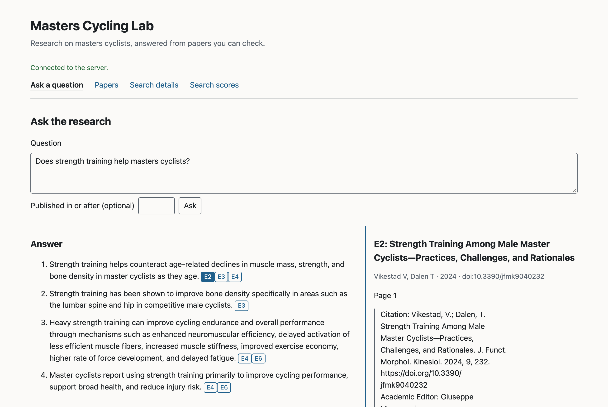
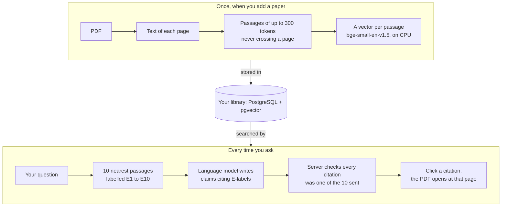
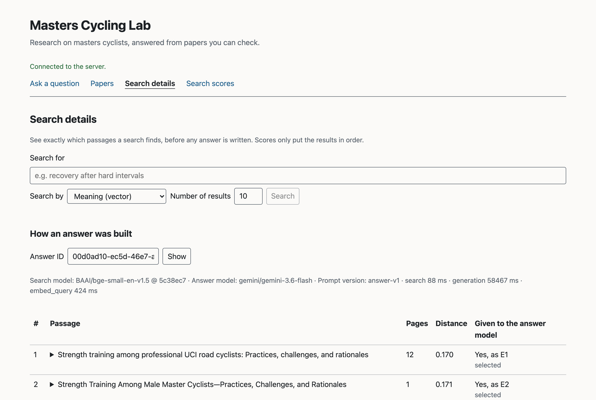
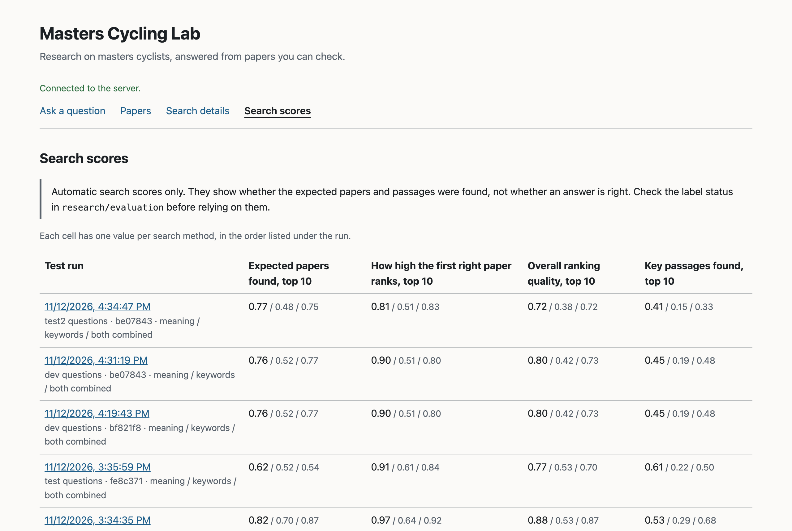
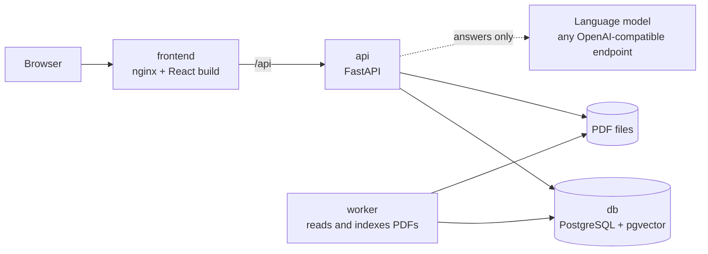

# Masters Cycling Lab

A local research workspace for evidence relevant to masters cyclists: upload research PDFs, search them,
ask questions and get answers whose citations point to the exact passage and PDF page they came from. It is also
a hands-on project for learning how retrieval-augmented generation works, with every step inspectable.

The app uses pretrained models only and gives no personal training or medical advice.



*A stored answer to "Does strength training help masters cyclists?" Each claim cites the passages it rests on;
clicking a label shows that passage and its page.*

## How it works



If search finds nothing, the app says there is not enough evidence and never calls the model. Searching and reading
work without a language model; only answers need one.

## At a glance

| | |
|---|---|
| Test library | 20 open-access (CC BY) papers on masters and older cyclists: 259 pages, 1,269 passages |
| Test questions | 74, each with the papers that answer it and the exact quotations, page by page; all reviewed by a person |
| Finding the right paper | 0.76 of relevant papers in the top 10 on practice questions, 0.77 on fresh ones (target 0.80) |
| Finding the right passage | 0.45 practice, 0.41 fresh (target 0.60): the main weakness |
| Answers checked so far | 19 of 19 claims supported by their cited passages, in the first 7 answers rated |
| Search time | 22 to 34 ms at the 95th percentile, on CPU |

Figures as of 2026-11-13; [evaluation](docs/evaluation.md) has the details and the caveats.

## Status

| Area | State |
|---|---|
| Upload, indexing, search, PDF viewer | Working and checked end to end (`make smoke`) |
| Answers with citations | Working with a real provider (Gemini 3.6 Flash on a free tier); a partial run on the practice questions so far |
| Search evaluation | Working: 74 reviewed questions, every run stored with its settings |
| Answer evaluation | Partly done: whether the model declines no-evidence and out-of-scope questions is not tested yet |

The [handoff](docs/handoff.md) lists what works, what was verified, the results and the next steps.

## Inside the app

**Search details** shows how an answer was built: which passages search found, how close each one was, and which
ones were sent to the model.



**Search scores** lists every evaluation run, with the scores for meaning-based search, keyword search and the two
combined.



## What runs where



Everything runs on your machine under Docker Compose, bound to `127.0.0.1`. The [code tour](docs/code-tour.md) follows
an upload and a question through the code, with more diagrams.

## Engineering decisions

Each one has a decision record with the context, the alternatives, the risks and when to revisit it. The
[decision index](docs/decisions/README.md) lists all seven.

- **No RAG framework.** Chunking, retrieval, prompt building and citation checks are small, and they are the parts
  worth inspecting. A framework would hide them ([0001](docs/decisions/0001-stack-and-structure.md)).
- **Model-independent answers.** Answers go to any OpenAI-compatible endpoint, and search works with no language
  model at all. Swapping providers is a configuration change ([0007](docs/decisions/0007-model-provider-abstraction.md)).
- **pgvector, not a separate vector database.** Vectors live next to the chunks, index versions and citations they
  belong to, so publishing a new index is one transaction ([0005](docs/decisions/0005-pgvector-instead-of-a-vector-database.md)).
- **PostgreSQL as the job queue.** Workers claim jobs with `FOR UPDATE SKIP LOCKED` and a lease, so a killed or
  stalled worker can't overwrite newer work, and a reindex never takes a working document out of search
  ([0003](docs/decisions/0003-postgres-job-queue-and-index-versions.md)). No Celery or Redis.
- **Exact search before approximate.** At this corpus size a sequential pgvector scan is fast and exact. An HNSW
  index waits until its recall can be compared against exact results ([0004](docs/decisions/0004-retrieval-and-citations.md)).
- **Citations resolved on the server.** The model can only cite passages it was sent, and the server checks every
  label before an answer is stored ([0004](docs/decisions/0004-retrieval-and-citations.md)).
- **A pinned embedding model.** `bge-small-en-v1.5` at a fixed revision runs on CPU; changing it means re-embedding
  every document ([0002](docs/decisions/0002-embedding-model.md)).
- **Changes must hold on held-out questions.** Hybrid search and a reranker both helped on dev questions and were
  not adopted because the gain did not hold on the held-out split ([0006](docs/decisions/0006-retrieval-evaluation-method.md)).

[GitHub Actions](.github/workflows/code-quality.yml) runs lint, type checks, the offline tests, an OpenAPI drift
check and the production build on every pull request and every merge to `main`, and blocks PRs that add dependencies
with known high-severity vulnerabilities ([what CI checks](docs/operations.md#continuous-integration)).

## Known limitations

- Passage retrieval is the main weakness: 0.45 and 0.41 against a 0.60 target (see [At a glance](#at-a-glance)).
- Answer evaluation is partial. Whether the model declines no-evidence and out-of-scope questions is untested.
- 74 questions and 20 papers is a small set. One question moves a dev average by about 3 points and a `test2`
  average by about 6, so differences of a few points are noise.
- No OCR: scanned PDFs are rejected, two-column pages can interleave, tables lose their layout and figures are
  skipped.
- Local and single-user, with no authentication. Don't expose it beyond `127.0.0.1`.

The [handoff](docs/handoff.md) and [evaluation caveats](docs/evaluation.md#caveats) have the full list.

## Requirements

- Docker with Compose
- Python 3.12 and [uv](https://docs.astral.sh/uv/) 0.13+ (for local checks and tests)
- Node.js 24 (`nvm use` reads `.nvmrc`)
- GNU Make

## Setup

[SETUP.md](SETUP.md) walks through a first install step by step, with troubleshooting. The short version:

```bash
cp .env.example .env
```

Set your own `POSTGRES_PASSWORD` in `.env` and use the same password in `DATABASE_URL`.

```bash
make bootstrap
```

`make bootstrap` installs the locked backend and frontend dependencies for local checks. It creates `.env` from
`.env.example` only if `.env` does not exist; it never overwrites it.

## Run it

```bash
make up
```

```bash
make migrate
```

```bash
make download-model
```

Add your own PDFs from the Papers page or with `make ingest FILE=/absolute/path/paper.pdf`. To load the 20-paper
open-access research corpus the evaluation uses (about 10 minutes on CPU):

```bash
make corpus-download
```

```bash
make corpus-ingest
```

Open http://127.0.0.1:8080. Check readiness at http://127.0.0.1:8080/api/v1/health/ready.
[docs/operations.md](docs/operations.md) covers ports, volumes, resets and troubleshooting.

For frontend or API development without Docker, run the database with `make up`, then the API and the Vite dev
server on the host in two terminals:

```bash
uv --directory backend run uvicorn masters_cycling_lab.main:create_app --factory --port 8000
```

```bash
npm --prefix frontend run dev
```

Open http://127.0.0.1:5173. API docs are at http://127.0.0.1:8000/api/docs.

## Commands

| Command | What it does |
|---|---|
| `make bootstrap` | Install locked dependencies |
| `make lint` | Ruff and ESLint |
| `make typecheck` | mypy and tsc |
| `make test` | Fast offline tests (no database, model download or LLM) |
| `make test-integration` | Tests against PostgreSQL in throwaway databases (needs `make up`) |
| `make test-model` | Tests with the real embedding model (downloads it on first use) |
| `make build` | Production frontend bundle |
| `make api-types` | Regenerate `backend/openapi.json` and the frontend's TypeScript types |
| `make check-api-types` | Fail if those generated files are out of date |
| `make up` / `make down` | Start / stop the Compose stack; data stays in Docker volumes |
| `make migrate` | Apply database migrations (the only thing that changes the schema) |
| `make download-model` | Download the pinned embedding model into the Docker volume |
| `make ingest FILE=/abs/path.pdf` | Upload one PDF and wait for the worker |
| `make corpus-download` | Fetch the 20 corpus PDFs from PMC Open Access (checked by SHA-256) |
| `make corpus-verify` | Check corpus PDFs against the manifest and report how many are searchable |
| `make corpus-ingest` | Upload the corpus with its manifest metadata and wait for the worker |
| `make labels-check` | Check every gold quotation against the stored page text |
| `make review REVIEWER="Your Name"` | Review provisional labels against the papers and record the verdict |
| `make evaluate SPLIT=dev` | Retrieval evaluation (vector, lexical and hybrid) with a stored artifact; `SPLIT=test2` for the fresh held-out split, from a clean checkout |
| `make test-live` | Opt-in: answer tests against the configured LLM provider (costs money) |
| `make backup` / `make restore BACKUP=backups/<time>` | Copy the database and PDFs out; replace all data from a copy |
| `make smoke` | End-to-end check against the running stack: upload, index, search, page, file, answer, delete |

## Configuration

All settings live in `.env` and are validated when the backend starts. [`.env.example`](.env.example) explains
each one. Things to know:

- **Embedding model.** `BAAI/bge-small-en-v1.5`, pinned to a commit hash. Changing it means re-embedding every
  document ([decision 0002](docs/decisions/0002-embedding-model.md)).
- **LLM provider.** Any OpenAI-compatible `/chat/completions` endpoint. Leave `LLM_BASE_URL` or `LLM_MODEL` empty
  to run without answer generation. When you ask a question, the question and the selected passages are sent to
  that provider. Keys stay on the server and are never sent to the browser.

## Documentation

- [Setup](SETUP.md): first install, step by step, with troubleshooting
- [Security policy](SECURITY.md): how to report a vulnerability, the threat model and safe-use guidance
- [Plain-English overview](docs/overview.html): what the app does, how it answers and how well it works, without jargon
- [Handoff](docs/handoff.md): what works, what was verified, results, open blockers and next steps
- [Roadmap](docs/roadmap.md): milestones, acceptance checks, assumptions and blockers
- [Architecture](docs/architecture.md): processes, layers, data model, security boundaries
- [Code tour](docs/code-tour.md): follow an upload and a question through the code, file by file
- [API reference](docs/api.md): every endpoint, the error format and where the OpenAPI spec lives
- [Operations](docs/operations.md): running, checking and resetting the local stack
- [Evaluation](docs/evaluation.md): metrics, targets and results
- [Dependencies and licences](docs/dependencies.md): pinned versions and what the licences mean
- [Decisions](docs/decisions/README.md): why the stack, model, queue, retrieval, evaluation and provider interface work the way they do

## Data and licensing

This is a single-user app for your own machine. It has no login, so don't expose it to a network.

Research PDFs are not stored in git. The corpus manifest records where each paper came from and whether it may be
redistributed. PyMuPDF is AGPL-3.0, which matters if you distribute the app or run it for other people; see
[dependencies.md](docs/dependencies.md#licensing-implications). The project itself has no licence yet.
