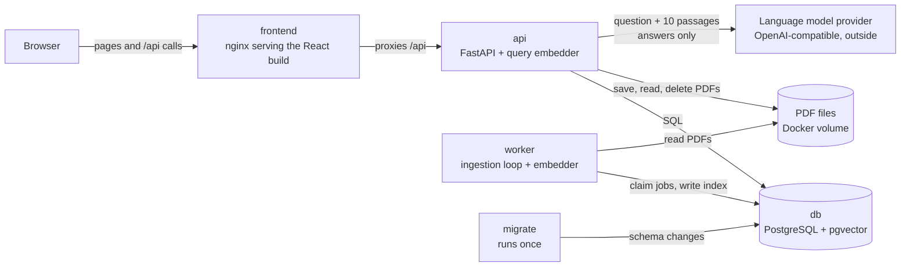
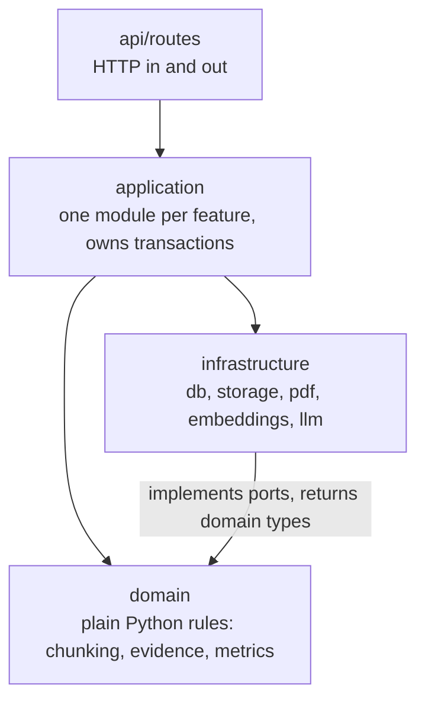
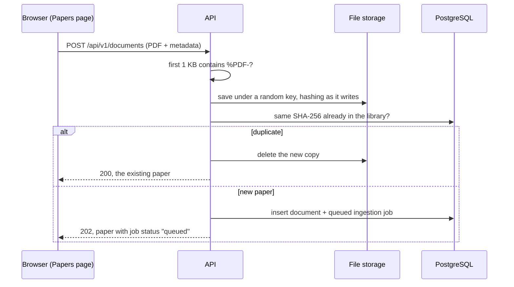
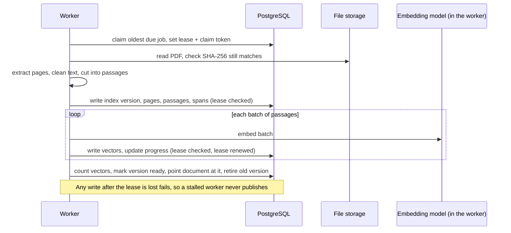
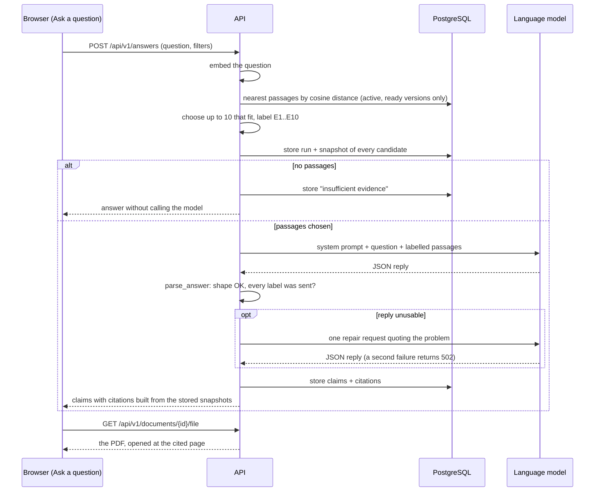

# Code tour

This page follows a PDF from upload to searchable passages, then a question from the browser to a cited answer,
naming the file and function that does each step. Read it with the code open. [Architecture](architecture.md) explains
why the code is laid out this way; this page shows where each step happens.

Paths are relative to the repository root. Backend code lives in `backend/src/masters_cycling_lab/`, shortened
below to `mcl/`.

## What runs where

Five containers, started by Docker Compose. Only the API and the worker run project code; `migrate` runs once and
exits. The language model is the only thing outside your machine, and only the API calls it.

## The four layers in one paragraph

`api/routes/` turns HTTP into function calls and back, and does nothing else. `application/` holds one module per
feature (documents, ingestion, retrieval, answering, evaluation, corpus); each function there owns its database
transaction. `domain/` is plain Python with no database or web imports: chunking, choosing passages, checking the
model's reply, and the evaluation metrics. `infrastructure/` is the code that talks to something outside Python:
PostgreSQL, the file system, PyMuPDF, the embedding model and the language model provider. Dependencies point inward:
routes call application code, application code calls domain and infrastructure code, and domain code imports nothing
from the other layers.

## 1. Uploading a PDF

| Step | Where |
|---|---|
| The Papers page sends the file | `frontend/src/features/documents/DocumentsView.tsx`, through `api` in `frontend/src/api/client.ts` |
| The route reads the form and metadata | `upload_document` in [mcl/api/routes/documents.py](../backend/src/masters_cycling_lab/api/routes/documents.py) |
| Check it is a PDF, store it, queue a job | `upload_document` in [mcl/application/documents.py](../backend/src/masters_cycling_lab/application/documents.py) |
| Write the file under a random key while hashing it | `LocalFileStorage.save` in [mcl/infrastructure/storage/local_files.py](../backend/src/masters_cycling_lab/infrastructure/storage/local_files.py) |
| Create the document row and its ingestion job | `record_upload` in [mcl/application/documents.py](../backend/src/masters_cycling_lab/application/documents.py) |

The upload request returns as soon as the job row exists. A file with the same SHA-256 as a paper already in the
library is recognised as a duplicate and changes nothing.

## 2. The worker builds the index

The worker is a separate process (`python -m masters_cycling_lab.worker`) with its own copy of the embedding model.

| Step | Where |
|---|---|
| Loop: claim a job, run it, repeat | `main` in [mcl/worker/main.py](../backend/src/masters_cycling_lab/worker/main.py) |
| Claim the oldest due job with a lease | `claim_next_job` in [mcl/application/ingestion.py](../backend/src/masters_cycling_lab/application/ingestion.py) |
| Run the job and record success, failure or retry | `JobRunner.run` in the same file |
| Every write checks the lease is still ours | `JobRunner.owned_job` in the same file |
| Read each page's text | `extract_pdf` in [mcl/infrastructure/pdf/pymupdf_extractor.py](../backend/src/masters_cycling_lab/infrastructure/pdf/pymupdf_extractor.py) |
| Clean the text, drop running headers and footers | `normalize_text` and `remove_repeated_edge_lines` in [mcl/domain/extraction.py](../backend/src/masters_cycling_lab/domain/extraction.py) |
| Cut pages into passages of at most 300 tokens | `chunk_pages` in [mcl/domain/chunking.py](../backend/src/masters_cycling_lab/domain/chunking.py) |
| Turn passages into vectors | `SentenceTransformerEmbedder.embed_documents` in [mcl/infrastructure/embeddings/sentence_transformers_adapter.py](../backend/src/masters_cycling_lab/infrastructure/embeddings/sentence_transformers_adapter.py) |
| Store pages, passages, spans and vectors, then switch the document to the new version | `JobRunner.build_index` in [mcl/application/ingestion.py](../backend/src/masters_cycling_lab/application/ingestion.py) |

`build_index` is the one function to read if you read only one. It writes a new index version next to the old one in
short transactions and switches the document over in a single final transaction, so search never sees a half-built
index. A document that can't be indexed (scanned, encrypted, too many pages) raises `IngestionProblem` and fails at
once with a stable code; any other error is retried with a growing delay, up to the job's attempt limit.

## 3. Asking a question

| Step | Where |
|---|---|
| The Ask a question page posts the question | `ResearchView` in `frontend/src/features/research/ResearchView.tsx`, calling `api.ask` |
| The route gets the embedder and the provider client | `ask` in [mcl/api/routes/answers.py](../backend/src/masters_cycling_lab/api/routes/answers.py); both are built once per process in [mcl/api/dependencies.py](../backend/src/masters_cycling_lab/api/dependencies.py) |
| The whole answer flow | `answer_question` in [mcl/application/answering.py](../backend/src/masters_cycling_lab/application/answering.py) |
| Embed the question and find the nearest passages | `search` and `vector_rows` in [mcl/application/retrieval.py](../backend/src/masters_cycling_lab/application/retrieval.py) |
| Pick up to 10 passages that fit, label them E1 to E10 | `choose_evidence` in [mcl/domain/answers.py](../backend/src/masters_cycling_lab/domain/answers.py) |
| Snapshot every candidate and why it was or wasn't sent | `store_evidence` in [mcl/application/answering.py](../backend/src/masters_cycling_lab/application/answering.py) |
| Build the prompt | `SYSTEM_PROMPT` and `user_message` in [mcl/domain/answers.py](../backend/src/masters_cycling_lab/domain/answers.py) |
| Call the provider | `OpenAICompatibleClient.complete` in [mcl/infrastructure/llm/openai_compatible.py](../backend/src/masters_cycling_lab/infrastructure/llm/openai_compatible.py) |
| Check the reply: JSON shape, every cited label was sent | `parse_answer` in [mcl/domain/answers.py](../backend/src/masters_cycling_lab/domain/answers.py) |
| Read the stored answer back with its citations | `get_answer` in [mcl/application/answering.py](../backend/src/masters_cycling_lab/application/answering.py) |
| Open the PDF at the cited page | `fileUrl` in `frontend/src/api/client.ts` adds `#page=N` to the file URL |

Three things in `answer_question` are easy to miss:

- If search finds no passages, it stores an "insufficient evidence" answer and returns without calling the model.
- A reply that fails `parse_answer` gets one repair request that quotes the problem back to the model. A second
  failure is stored as a failed run and returned to the browser as `502 GENERATION_INVALID`.
- Citation titles, pages and excerpts come from the `query_evidence` snapshot, never from the model's text.

The Search details page (`frontend/src/features/retrieval-debug/RetrievalView.tsx`) reads the same stored run through
`GET /api/v1/answers/{id}/debug`, which is how you see every candidate passage and why it was or wasn't sent.

## 4. Measuring search

`make evaluate` runs `evaluate` in [mcl/cli.py](../backend/src/masters_cycling_lab/cli.py), which calls
`run_evaluation` in [mcl/application/evaluation.py](../backend/src/masters_cycling_lab/application/evaluation.py).
It loads the labelled questions from `research/evaluation/questions.jsonl`, finds each gold quotation on its page of
the stored text, runs the same `search` the answer flow uses, and scores the results with the functions in
[mcl/domain/evaluation.py](../backend/src/masters_cycling_lab/domain/evaluation.py). Each run is saved as a database
row and a JSON file in `artifacts/evaluations/`. [Evaluation](evaluation.md) explains the metrics and results.

## Where to make common changes

| To change | Start in |
|---|---|
| Passage size or overlap | `CHUNK_MAX_TOKENS` and `CHUNK_OVERLAP_TOKENS` in `.env`; the algorithm is in `domain/chunking.py`. Run Reindex afterwards |
| How many passages the model sees | `RETRIEVAL_CONTEXT_K` in `.env`; selection rules in `choose_evidence` |
| The prompt | `SYSTEM_PROMPT` in `domain/answers.py`. Bump `PROMPT_VERSION` so stored runs stay comparable |
| The embedding model | [decision 0002](decisions/0002-embedding-model.md) first: every document must be re-embedded |
| A new API endpoint | A route in `api/routes/`, the logic in `application/`, then `make api-types` to regenerate the frontend types |
| The database schema | A new Alembic migration in `backend/migrations/versions/` and the model in `infrastructure/db/models.py`; `make migrate` applies it |
| Settings | `config.py`, with a matching entry in `.env.example` |
